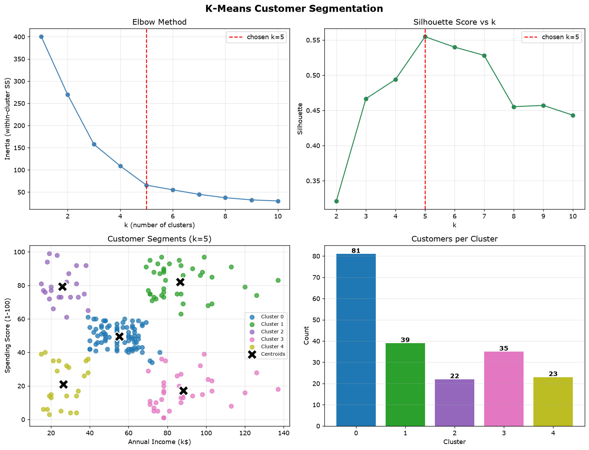

# K-Means Customer Segmentation

An end-to-end unsupervised learning mini-project that segments mall customers into
actionable groups using **K-Means clustering**, built on the classic
[Mall Customer Segmentation dataset](https://www.kaggle.com/datasets/vjchoudhary7/customer-segmentation-tutorial-in-python).

The entire training pipeline lives in **one file** (`kmeans_train.py`) and runs
unchanged **locally or in Google Colab** — it even auto-downloads the dataset if missing.

---

## Snapshot

| | |
|---|---|
| **Algorithm** | K-Means (Lloyd's, via `sklearn.cluster.KMeans`) |
| **Features used** | `Annual Income (k$)`, `Spending Score (1-100)` |
| **Rows** | 200 customers |
| **Clusters (k)** | 5 — chosen by elbow method **and** silhouette score |
| **Final metrics** | Inertia = 65.57, Silhouette = **0.555** |
| **Reproducibility** | `random_state=42`, `n_init=10` |

---

## Results



*(If the image does not render in Colab/GitHub, run `kmeans_train.py` — it regenerates `output/kmeans_clusters.png`.)*

The 4-panel figure above shows, in order:

1. **Elbow method** — inertia drops steeply, then flattens after k=5 (the "elbow")
2. **Silhouette scores** — peak at k=5 (0.555), independently confirming the elbow
3. **Cluster scatter** — the five segments with their centroids (X markers)
4. **Cluster sizes** — 81 / 39 / 22 / 35 / 23 customers, fairly balanced

## The 5 customer segments

| Cluster | Size | Income | Score | Interpretation |
|---|---|---|---|---|
| 0 | 81 | $55.3k | 49.5 | **Standard** — average income, moderate spenders |
| 1 | 39 | $86.5k | 82.1 | **Premium target** — high income, high spenders |
| 2 | 22 | $25.7k | 79.4 | **Impulsive** — low income, big spenders |
| 3 | 35 | $88.2k | 17.1 | **Careful rich** — high income, low spenders (untapped market) |
| 4 | 23 | $26.3k | 20.9 | **Budget** — low income, low spenders |

---

## Dataset

| Column | Description | Values |
|---|---|---|
| `CustomerID` | Row identifier (dropped) | 1–200 |
| `Gender` | Customer gender | Male / Female |
| `Age` | Customer age | 18–70 |
| `Annual Income (k$)` | Yearly income in $1000s | 15–137 |
| `Spending Score (1-100)` | Mall-assigned spend behavior score | 1–99 |

## Data quality & cleaning

The dataset was audited programmatically (full report: `output/preparation_report.txt`):

- **Missing values:** 0 · **Duplicates:** 0 · **Invalid labels:** 0
- **Range validation:** all values within plausible bounds
- **Outlier scan (IQR 1.5x fence):** only 2 points flagged (income = 137k) — **retained**,
  since they are genuine high-earning customers and valuable segmentation signal
- **Transformations:** dropped `CustomerID`, selected the two behavioral features,
  standardized with `StandardScaler`

---

## Pipeline (in `kmeans_train.py`)

```
1. Load raw data        -> auto-downloads the CSV if missing
2. Prepare features     -> select income + spending score, StandardScaler
3. Explore k            -> inertia + silhouette for k = 1..10
4. Train KMeans         -> k=5, n_init=10, random_state=42
5. Visualize & persist  -> 4-panel matplotlib figure + model/scaler/CSV artifacts
```

## Optimization notes

- **Feature scaling** — income (15–137) and score (1–99) have very different ranges.
  Without `StandardScaler`, raw income would dominate Euclidean distance and crush
  the spending dimension. Scaling puts both features on equal footing (mean 0, sd 1).
- **Feature selection** — `CustomerID` is a pure row identifier (no signal), and
  age/gender add little for this demo; clustering on the two most behaviorally
  meaningful features gives clean, interpretable, well-separated segments.
- **Choosing k objectively** — instead of guessing k, both the elbow method (inertia)
  and silhouette score were computed for k = 1..10; both independently peaked/hinted
  at k=5. Silhouette also penalizes overly fragmented solutions (k=8 gives 0.455, worse).
- **Stable initialization** — K-Means is sensitive to initial centroid placement.
  `n_init=10` runs the algorithm 10 times with different seeds and keeps the best,
  and `random_state=42` makes results exactly reproducible.
- **Retained outliers** — the two 137k incomes are real customers; trimming them
  would bias the "Premium target" segment. Clustering is kept on all 200 rows.
- **Scalars persisted** — `scaler.pkl` + `kmeans_model.pkl` let new customers be
  transformed with the *training* scaler and assigned to a segment without refitting.

---

## Project structure

```
ml-project/
├── Mall_Customers.csv            # raw dataset (Kaggle)
├── prepare_data.py               # audit + cleaning/ prep script (no training)
├── kmeans_train.py               # one-file train + visualize pipeline
├── data/
│   ├── Mall_Customers_clean.csv  # cleaned dataset
│   └── features_scaled.csv       # scaled feature matrix
├── models/
│   ├── scaler.pkl                # fitted StandardScaler
│   └── (kmeans_model.pkl, scaler.pkl also written by kmeans_train.py)
├── output/
│   ├── preparation_report.txt    # data-quality audit log
│   └── kmeans_clusters.png       # 4-panel result figure
├── customers_with_clusters.csv   # customers labeled with cluster
└── README.md
```

## How to run

**Locally** (requires `pandas scikit-learn matplotlib joblib`):

```bash
python kmeans_train.py
```

**Google Colab** — upload `kmeans_train.py` and run one cell:

```python
!python kmeans_train.py
```

Or simply paste the file contents into a single Colab cell. Colab already has all
dependencies preinstalled; the dataset auto-downloads if not present.
To change the number of clusters, edit `CHOSEN_K` at the top of the file.

## Possible extensions

- 3D clustering using `age, annual_income, spending_score`
- Gender breakdown per segment (marketing angle)
- Auto-select k via `max(silhouette)` instead of a hard-coded value
- Assign new customers: `kmeans.predict(scaler.transform([[income, score]]))`
